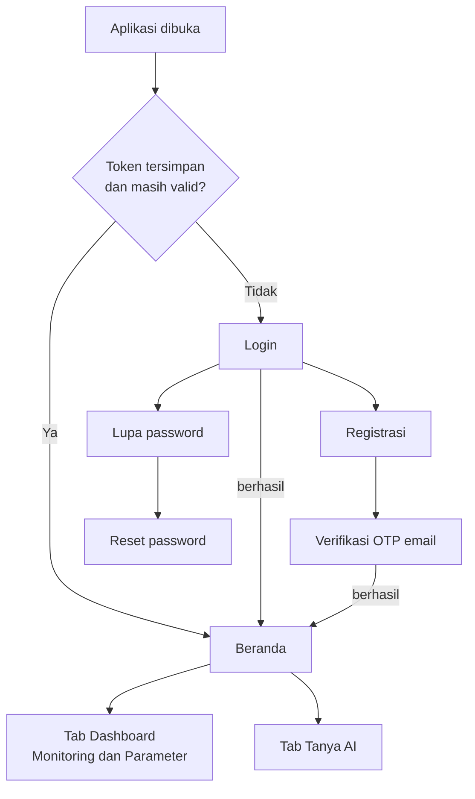
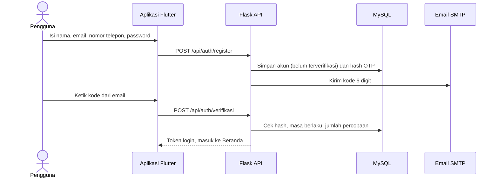
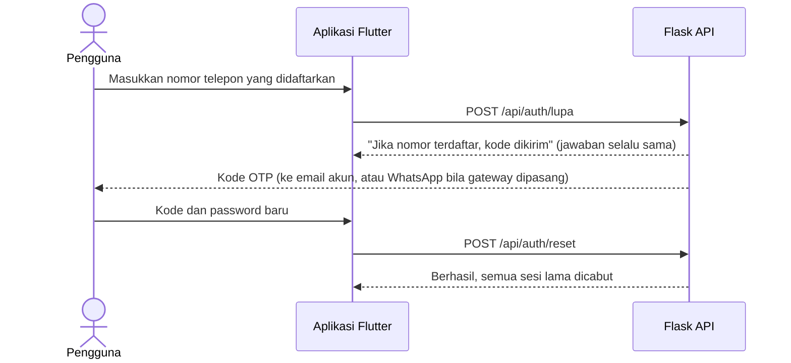

# Strawberry Care

Aplikasi monitoring greenhouse stroberi hidroponik: **login & registrasi aman**, **dashboard monitoring** (sensor, kipas/pompa, diagnosis penyakit daun lewat kamera), dan **Tanya AI** (asisten agronomi berbasis Gemini).

Dokumen ini adalah panduan membangun sistemnya **dari awal**, dimulai dari database, lalu backend Flask, lalu aplikasi Flutter.

## Daftar isi

1. [Gambaran sistem](#1-gambaran-sistem)
2. [Alur pengguna](#2-alur-pengguna)
3. [Struktur proyek](#3-struktur-proyek)
4. [Tahap 0: Prasyarat](#tahap-0-prasyarat)
5. [Tahap 1: Database MySQL](#tahap-1-database-mysql)
6. [Tahap 2: Backend, autentikasi](#tahap-2-backend-autentikasi)
7. [Tahap 3: Backend, Tanya AI](#tahap-3-backend-tanya-ai)
8. [Tahap 4: Mengamankan endpoint yang sudah ada](#tahap-4-mengamankan-endpoint-yang-sudah-ada)
9. [Tahap 5: Aplikasi Flutter](#tahap-5-aplikasi-flutter)
10. [Tahap 6: Uji menyeluruh](#tahap-6-uji-menyeluruh)
11. [Tahap 7: Keamanan sebelum dipakai sungguhan](#tahap-7-keamanan-sebelum-dipakai-sungguhan)
12. [Referensi API](#referensi-api)
13. [Pemecahan masalah](#pemecahan-masalah)

---

## 1. Gambaran sistem

```
┌────────────────┐   HTTP(S) + token    ┌──────────────────────┐     ┌──────────────┐
│ Aplikasi       │ ───────────────────► │ Flask (app.py)       │ ──► │ MySQL        │  akun, OTP
│ Flutter        │ ◄─────────────────── │  /api/auth/*         │     └──────────────┘
└────────────────┘                      │  /api/ai/*           │ ──► Gemini (key di server)
                                        │  /api/sensor, /control│ ──► Firebase (riwayat sensor)
┌────────────────┐   X-Device-Key       │  /api/predict-disease│ ──► model Keras (buah & daun)
│ ESP32-CAM /    │ ───────────────────► │                      │
│ ESP8266        │                      └──────────────────────┘
└────────────────┘
```

### Pembagian peran komponen

| Komponen | Tugas | Yang disimpan / dikerjakan |
|---|---|---|
| **Flask** | Backend dan API | Melayani aplikasi dan perangkat, menjalankan prediksi **MobileNetV2** (kematangan buah dan penyakit daun), dan **mengontrol perangkat** (kipas, pompa, kamera ESP) |
| **MySQL** | Akun dan keamanan | Akun pengguna, **hash** password, kode **OTP**, dan data untuk **autentikasi** (siapa kamu) serta **otorisasi** (apa yang boleh kamu akses) |
| **Firebase** | Data kebun | **Riwayat deteksi** dan **data sensor** sistem stroberi (kode yang sudah ada di `app.py`: `riwayat_strawberry` dan `sensor_greenhouse/latest`) |

Aturan pemisahannya: data tentang **orang** ada di MySQL, data tentang **kebun** ada di Firebase, dan Flask adalah satu-satunya yang boleh menyentuh keduanya. Aplikasi dan perangkat hanya berbicara dengan Flask.

Catatan sesuai kondisi kode saat ini:

- **Otorisasi** di panduan ini berarti: hanya pengguna yang sudah login (`@login_wajib`) yang boleh memakai endpoint aplikasi, dan hanya perangkat ber-`X-Device-Key` yang boleh mengirim data sensor/foto. **Peran** (admin atau pengguna biasa) belum ada. Bila diperlukan, tambahkan kolom `role` di tabel `users` lalu periksa di dekorator.
- **Data di Firebase belum dipisah per pengguna.** Sistem ini mengasumsikan satu greenhouse yang dilihat semua akun yang sudah login. Bila nanti ada banyak kebun atau banyak pemilik, kunci data Firebase dengan id kebun dan hubungkan ke akun di MySQL.
- **Tab riwayat deteksi belum ada** di aplikasi. Datanya sudah masuk ke Firebase oleh Flask. Untuk menampilkannya, tambahkan satu endpoint di Flask yang membaca `riwayat_strawberry` (aplikasi tidak mengakses Firebase langsung, karena kunci Firebase Admin hanya boleh ada di server).

Prinsip yang dipegang:

- **Aplikasi tidak pernah terhubung langsung ke MySQL.** Semua lewat API Flask. Kalau kredensial database ada di aplikasi, siapa pun yang membongkar APK bisa membaca seluruh data pengguna.
- **Password tidak pernah disimpan apa adanya**, hanya hash. Kode OTP juga hanya disimpan sebagai hash dan berumur 10 menit.
- **Gemini dipanggil dari server.** Pada kode yang sudah ada, Gemini dipanggil dari `main.dart` (Flutter), sedangkan `app.py` belum memanggilnya. Di sini panggilan itu dipindah ke Flask supaya API key tidak ikut terpasang di aplikasi.
- **Perangkat (ESP) dan pengguna memakai kunci yang berbeda**: perangkat dengan `X-Device-Key`, pengguna dengan token login. Dengan begitu, firmware ESP yang sudah berjalan tidak ikut rusak saat login diwajibkan.

### Status verifikasi kode di dokumen ini

| Bagian | Sudah diuji? |
|---|---|
| Logika autentikasi (registrasi, OTP, kunci akun, reset password, token) | Ya, 52 pemeriksaan otomatis (termasuk fungsi pembantu) dengan database tiruan di memori |
| Tanya AI (validasi, batas pemakaian, penanganan error) | Ya, 8 pemeriksaan dengan SDK Gemini tiruan |
| Skrip SQL pada MySQL sungguhan | **Belum**: lingkungan pengujian tidak punya MySQL. Jalankan Tahap 1 dan baca pesan errornya bila ada |
| Panggilan SDK `google-genai` yang asli | **Belum**: SDK tidak bisa dipasang di lingkungan pengujian. Cocokkan dengan dokumentasi resmi bila ada error |
| Kode Flutter | **Belum dikompilasi** (tidak ada Flutter SDK di lingkungan pengujian). Tanda kurung sudah diperiksa, tetapi jalankan `flutter analyze` |

---

## 2. Alur pengguna

### Navigasi aplikasi



### Registrasi dengan OTP email



### Lupa password dengan nomor telepon



### Catatan penting tentang "lupa password dengan nomor telepon"

Mengetahui nomor telepon seseorang **tidak membuktikan** bahwa kamu adalah pemilik akunnya. Jadi nomor telepon dipakai untuk **menemukan akun**, lalu pemiliknya tetap harus membuktikan diri dengan kode OTP. Ada dua mode (diatur lewat `RESET_CHANNEL` di `.env`):

| Mode | Kode OTP dikirim ke | Biaya | Keterangan |
|---|---|---|---|
| `email` (bawaan) | Email akun | Gratis | Langsung bisa dipakai. Nomor telepon dipakai sebagai pencari akun |
| `wa` | Nomor telepon (WhatsApp/SMS) | Berbayar | Perlu akun layanan gateway pihak ketiga. Isi fungsi `kirim_wa()` di `mailer.py` sesuai dokumentasi gateway yang dipilih |

Aplikasi Flutter tidak perlu berubah saat berpindah mode, karena yang berubah hanya cara server mengirim kode.

### Aturan keamanan yang diterapkan

| Aturan | Nilai |
|---|---|
| Masa berlaku OTP | 10 menit |
| Salah ketik OTP | 5 kali, lalu kode hangus |
| Jeda minta kode baru | 60 detik |
| Gagal login berturut-turut | 5 kali, akun dikunci 5 menit |
| Masa berlaku token login | 7 hari. Token otomatis tidak berlaku setelah password diganti |
| Password | minimal 8 karakter, mengandung huruf dan angka |
| Lupa password | Jawaban server sama ada atau tidaknya nomor itu, supaya nomor orang lain tidak bisa ditebak |

---

## 3. Struktur proyek

```
strawberry_project/
├── backend/                      <- proyek Flask yang sudah ada
│   ├── app.py                    <- dimodifikasi (Tahap 2-4)
│   ├── db.py                     <- baru
│   ├── keamanan.py               <- baru
│   ├── mailer.py                 <- baru
│   ├── auth.py                   <- baru
│   ├── ai.py                     <- baru
│   ├── skema.sql                 <- baru (Tahap 1)
│   ├── .env                      <- baru, JANGAN masuk git
│   ├── .gitignore
│   └── model/ ...                <- model Keras yang sudah ada
└── strawberry_app/               <- proyek Flutter
    └── lib/
        ├── main.dart             <- titik masuk + AuthGate + tema
        ├── config.dart           <- alamat server
        ├── token_store.dart      <- penyimpanan token terenkripsi
        ├── api_client.dart       <- semua panggilan ke server
        ├── auth_state.dart       <- status login
        └── features/
            ├── auth/             <- login, registrasi, OTP, lupa & reset password
            ├── home/             <- kerangka AppBar + navbar bawah
            ├── dashboard/        <- tab Monitoring dan tab Parameter
            └── ai_chat/          <- Tanya AI
```

---

## Tahap 0: Prasyarat

- Python 3.10+ dan proyek Flask yang sudah berjalan (`app.py`).
- MySQL 8 atau MariaDB 10.5+. Pengguna Laragon sudah punya MySQL di dalamnya (nyalakan lewat *Start All*). Alternatifnya XAMPP.
- Flutter SDK dan Android Studio (atau HP Android dengan mode developer).
- Akun email untuk mengirim OTP. Untuk Gmail: aktifkan *Verifikasi 2 langkah*, lalu buat **App password** di pengaturan akun Google. Password email biasa tidak akan diterima.
- API key Gemini dari [aistudio.google.com](https://aistudio.google.com). **Buat key baru** bila key lama pernah tertulis di kode atau dibagikan.

---

## Tahap 1: Database MySQL

### 1.1 Rancangan tabel

```
users                                  otp_codes
─────────────────────────              ─────────────────────────
id (PK)                          ┌──── id (PK)
nama                             │     user_id (FK -> users.id, hapus berantai)
email        (unik)              │     purpose  'register' | 'reset'
phone        (unik, +62...)      │     code_hash   (hash, bukan kode asli)
password_hash                    │     attempts    (jumlah salah ketik)
is_verified  (0/1)               │     expires_at
token_version                    │     used_at
gagal_login                      │     created_at
terkunci_sampai                  │
created_at / updated_at ◄────────┘  (1 pengguna : banyak kode)
```

| Kolom | Gunanya |
|---|---|
| `phone` berbentuk E.164 (`+6281234567890`) | Nomor ditulis dengan banyak gaya (`0812-...`, `+62 812...`). Disimpan dalam satu bentuk agar pencarian di fitur lupa password selalu cocok |
| `is_verified` | Akun baru belum bisa login sampai OTP email benar |
| `token_version` | Naik 1 saat password diganti atau "keluar dari semua perangkat". Token lama langsung tidak berlaku |
| `gagal_login`, `terkunci_sampai` | Pembatas tebak-tebak password |
| `code_hash` dan `attempts` | Kode OTP tidak tersimpan asli, dan dibatasi 5 kali salah ketik |

Tabel untuk **parameter** (batas suhu, jadwal, dan sebagainya) sengaja belum dibuat, karena fitur itu masih kosong. Tambahkan saat fiturnya dikerjakan.

### 1.2 Jalankan skrip

Simpan sebagai `backend/skema.sql`. **Ganti `GANTI_DENGAN_PASSWORD_KUAT`** sebelum menjalankan.

```sql
-- =====================================================
-- Skema database Strawberry Care (MySQL 8 / MariaDB 10.5+)
-- Jalankan sebagai root / admin MySQL.
-- =====================================================
CREATE DATABASE IF NOT EXISTS strawberry_care
  CHARACTER SET utf8mb4 COLLATE utf8mb4_unicode_ci;
USE strawberry_care;

-- Akun pengguna
CREATE TABLE IF NOT EXISTS users (
  id              INT UNSIGNED     NOT NULL AUTO_INCREMENT,
  nama            VARCHAR(60)      NOT NULL,
  email           VARCHAR(120)     NOT NULL,
  phone           VARCHAR(20)      NOT NULL,                 -- format E.164, mis. +6281234567890
  password_hash   VARCHAR(255)     NOT NULL,                 -- hash, BUKAN password asli
  is_verified     TINYINT(1)       NOT NULL DEFAULT 0,       -- 1 setelah OTP email benar
  token_version   INT UNSIGNED     NOT NULL DEFAULT 0,       -- naik saat password diganti: token lama otomatis tidak berlaku
  gagal_login     TINYINT UNSIGNED NOT NULL DEFAULT 0,
  terkunci_sampai DATETIME         NULL,
  created_at      DATETIME         NOT NULL DEFAULT CURRENT_TIMESTAMP,
  updated_at      DATETIME         NOT NULL DEFAULT CURRENT_TIMESTAMP ON UPDATE CURRENT_TIMESTAMP,
  PRIMARY KEY (id),
  UNIQUE KEY uq_users_email (email),
  UNIQUE KEY uq_users_phone (phone)
) ENGINE=InnoDB DEFAULT CHARSET=utf8mb4 COLLATE=utf8mb4_unicode_ci;

-- Kode OTP (disimpan sebagai hash, berlaku singkat)
CREATE TABLE IF NOT EXISTS otp_codes (
  id         INT UNSIGNED     NOT NULL AUTO_INCREMENT,
  user_id    INT UNSIGNED     NOT NULL,
  purpose    ENUM('register','reset') NOT NULL,
  code_hash  CHAR(64)         NOT NULL,
  attempts   TINYINT UNSIGNED NOT NULL DEFAULT 0,
  expires_at DATETIME         NOT NULL,
  used_at    DATETIME         NULL,
  created_at DATETIME         NOT NULL DEFAULT CURRENT_TIMESTAMP,
  PRIMARY KEY (id),
  KEY idx_otp_cari (user_id, purpose, used_at, id),
  CONSTRAINT fk_otp_user FOREIGN KEY (user_id) REFERENCES users (id) ON DELETE CASCADE
) ENGINE=InnoDB DEFAULT CHARSET=utf8mb4 COLLATE=utf8mb4_unicode_ci;

-- User khusus untuk Flask: hanya boleh membaca/menulis data, tidak boleh mengubah struktur.
-- GANTI password di bawah sebelum dijalankan.
CREATE USER IF NOT EXISTS 'strawberry_app'@'localhost' IDENTIFIED BY 'GANTI_DENGAN_PASSWORD_KUAT';
GRANT SELECT, INSERT, UPDATE, DELETE ON strawberry_care.* TO 'strawberry_app'@'localhost';
FLUSH PRIVILEGES;
```

Cara menjalankan (pilih salah satu):

- **HeidiSQL / phpMyAdmin (Laragon/XAMPP)**: buka tab SQL, tempel seluruh isi, jalankan.
- **Terminal**: `mysql -u root -p < skema.sql` (di Laragon, buka *Terminal* dari menu Laragon agar `mysql` dikenali).

### 1.3 Periksa hasilnya

```sql
USE strawberry_care;
SHOW TABLES;            -- users, otp_codes
DESCRIBE users;
```

Uji juga bahwa user aplikasi bisa masuk:

```powershell
mysql -u strawberry_app -p strawberry_care -e "SELECT COUNT(*) FROM users;"
```

Hasil `0` berarti benar (belum ada pengguna). Bila muncul `Access denied`, password di `skema.sql` tidak sama dengan yang kamu ketik, atau user dibuat dengan host lain (`'localhost'` hanya berlaku bila Flask dan MySQL berada di komputer yang sama).

> Port MySQL (3306) **jangan dibuka ke jaringan**. Hanya Flask di komputer yang sama yang perlu mengaksesnya.

---

## Tahap 2: Backend, autentikasi

### 2.1 Pasang dependensi

```powershell
cd backend
pip install PyMySQL PyJWT python-dotenv
```

Tambahkan ketiganya ke `requirements.txt` bila proyekmu memilikinya.

### 2.2 Siapkan `.env`

Salin template ini menjadi `backend/.env`, lalu isi. Untuk `JWT_SECRET` dan `OTP_PEPPER`, buat nilai acak panjang dengan:

```powershell
python -c "import secrets; print(secrets.token_urlsafe(48))"
```

```ini
# ===== Database =====
DB_HOST=127.0.0.1
DB_PORT=3306
DB_USER=strawberry_app
DB_PASSWORD=ISI_SAMA_DENGAN_PASSWORD_DI_skema.sql
DB_NAME=strawberry_care

# ===== Rahasia (buat nilai acak panjang untuk masing-masing) =====
# python -c "import secrets; print(secrets.token_urlsafe(48))"
JWT_SECRET=
OTP_PEPPER=

# ===== Email OTP (Gmail: aktifkan verifikasi 2 langkah, lalu buat "App password") =====
SMTP_HOST=smtp.gmail.com
SMTP_PORT=587
SMTP_USER=emailkamu@gmail.com
SMTP_PASS=
SMTP_FROM=Strawberry Care <emailkamu@gmail.com>

# email = kode reset dikirim ke email akun (nomor telepon dipakai untuk menemukan akun)
# wa    = kode dikirim ke nomor telepon lewat gateway WhatsApp/SMS (isi kirim_wa() di mailer.py)
RESET_CHANNEL=email

# 1 = kode OTP hanya dicetak di terminal Flask (untuk uji). WAJIB 0 saat dipakai sungguhan.
OTP_DEV_ECHO=1

# Kunci untuk ESP32/ESP8266 (kosong = endpoint perangkat tetap terbuka seperti sekarang)
DEVICE_KEY=

# ===== Gemini =====
GEMINI_API_KEY=
GEMINI_MODEL=gemini-3.8-flash
```

Buat juga `backend/.gitignore` agar rahasia tidak ikut terunggah:

```
.env
firebase_key.json
__pycache__/
static/latest*.jpg
```

> Selama menguji, biarkan `OTP_DEV_ECHO=1`: kode OTP tidak dikirim lewat email, tetapi dicetak di terminal Flask. Ubah ke `0` setelah SMTP diisi dan dicoba.

### 2.3 Tambahkan file backend

Empat file di bawah ditaruh di folder `backend/` (sejajar dengan `app.py`).

**`db.py`**: koneksi MySQL. Commit otomatis bila berhasil, rollback bila error.

```python
"""Koneksi MySQL. Satu koneksi per blok `with db() as cur:`; commit otomatis, rollback bila error."""
import os
from contextlib import contextmanager

import pymysql
from pymysql.cursors import DictCursor


def _koneksi():
    return pymysql.connect(
        host=os.getenv("DB_HOST", "127.0.0.1"),
        port=int(os.getenv("DB_PORT", "3306")),
        user=os.getenv("DB_USER", "strawberry_app"),
        password=os.environ["DB_PASSWORD"],
        database=os.getenv("DB_NAME", "strawberry_care"),
        charset="utf8mb4",
        cursorclass=DictCursor,
        autocommit=False,
        connect_timeout=5,
    )


@contextmanager
def db():
    conn = _koneksi()
    try:
        with conn.cursor() as cur:
            yield cur
        conn.commit()
    except Exception:
        conn.rollback()
        raise
    finally:
        conn.close()
```

**`keamanan.py`**: pembuat dan pencocok kode OTP, validasi, dan normalisasi nomor telepon (tanpa dependensi luar).

```python
"""Fungsi pembantu tanpa dependensi luar: kode OTP, validasi input, normalisasi nomor telepon."""
import hashlib
import hmac
import os
import re
import secrets


def buat_kode(panjang: int = 6) -> str:
    """Kode OTP acak yang aman secara kriptografis (bukan random.randint)."""
    return "".join(str(secrets.randbelow(10)) for _ in range(panjang))


def hash_kode(user_id: int, purpose: str, kode: str) -> str:
    pepper = os.environ["OTP_PEPPER"].encode()
    return hmac.new(pepper, f"{user_id}:{purpose}:{kode}".encode(), hashlib.sha256).hexdigest()


def kode_cocok(hash_tersimpan: str, user_id: int, purpose: str, kode: str) -> bool:
    return hmac.compare_digest(hash_tersimpan, hash_kode(user_id, purpose, kode))


def normalisasi_hp(teks) -> str | None:
    """'0812-3456-7890', '+62 812 3456 7890', '62812...' -> '+6281234567890'. Tidak valid -> None.
    Hanya nomor seluler Indonesia (diawali 08 / +628)."""
    d = re.sub(r"[^\d+]", "", str(teks or ""))
    if d.startswith("+"):
        d = d[1:]
    elif d.startswith("00"):
        d = d[2:]
    if d.startswith("0"):
        d = "62" + d[1:]
    elif d.startswith("8"):
        d = "62" + d
    if not re.fullmatch(r"628\d{8,11}", d):
        return None
    return "+" + d


_EMAIL = re.compile(r"^[A-Za-z0-9._%+\-]+@[A-Za-z0-9.\-]+\.[A-Za-z]{2,}$")


def email_valid(email: str) -> bool:
    return bool(email) and len(email) <= 120 and bool(_EMAIL.match(email))


def cek_password(p: str) -> str | None:
    """Mengembalikan pesan kesalahan, atau None bila password cukup kuat."""
    if len(p) < 8:
        return "Password minimal 8 karakter."
    if len(p) > 72:
        return "Password maksimal 72 karakter."
    if not re.search(r"[A-Za-z]", p) or not re.search(r"\d", p):
        return "Password harus mengandung huruf dan angka."
    return None
```

**`mailer.py`**: pengirim email, dan tempat menyambungkan WhatsApp/SMS.

```python
"""Pengiriman email lewat SMTP. Dengan OTP_DEV_ECHO=1 isi email hanya dicetak di terminal (untuk uji lokal)."""
import os
import smtplib
import ssl
from email.message import EmailMessage


def kirim_email(tujuan: str, subjek: str, isi: str) -> None:
    if os.getenv("OTP_DEV_ECHO") == "1":
        print(f"\n[DEV] Email ke {tujuan}\n  Subjek: {subjek}\n  {isi}\n")
        return
    user = os.environ["SMTP_USER"]
    msg = EmailMessage()
    msg["From"] = os.getenv("SMTP_FROM", user)
    msg["To"] = tujuan
    msg["Subject"] = subjek
    msg.set_content(isi)
    with smtplib.SMTP(os.environ["SMTP_HOST"], int(os.getenv("SMTP_PORT", "587")), timeout=15) as s:
        s.starttls(context=ssl.create_default_context())
        s.login(user, os.environ["SMTP_PASS"])
        s.send_message(msg)


def kirim_wa(nomor: str, teks: str) -> None:
    """Tempat menyambungkan gateway WhatsApp/SMS pilihanmu (butuh akun layanan pihak ketiga)."""
    if os.getenv("OTP_DEV_ECHO") == "1":
        print(f"\n[DEV] Pesan ke {nomor}: {teks}\n")
        return
    raise NotImplementedError("Isi fungsi kirim_wa() sesuai dokumentasi gateway yang kamu pakai.")
```

**`auth.py`**: seluruh endpoint registrasi, login, lupa password, serta dekorator `login_wajib` dan `kunci_perangkat`.

```python
"""Autentikasi: registrasi + OTP email, login (JWT), lupa password via nomor telepon, dan dekorator pengaman."""
import hmac
import os
from datetime import datetime, timedelta, timezone
from functools import wraps

import jwt
from flask import Blueprint, current_app, g, jsonify, request
from werkzeug.security import check_password_hash, generate_password_hash

from db import db
from keamanan import buat_kode, cek_password, email_valid, hash_kode, kode_cocok, normalisasi_hp
from mailer import kirim_email, kirim_wa

auth_bp = Blueprint("auth", __name__, url_prefix="/api/auth")

OTP_MENIT = 10          # masa berlaku kode
OTP_MAKS_SALAH = 5      # salah ketik kode -> kode hangus
OTP_JEDA_DETIK = 60     # jeda minimal antar permintaan kode
LOGIN_MAKS_GAGAL = 5    # gagal login berturut-turut -> akun dikunci sementara
KUNCI_MENIT = 5
JWT_HARI = 7

_HASH_PALSU = generate_password_hash("hash-palsu-untuk-menyamakan-waktu")


# ---------------------------------------------------------------- pembantu umum
def _json() -> dict:
    d = request.get_json(silent=True)
    return d if isinstance(d, dict) else {}


def _err(pesan: str, kode: int = 400, **extra):
    return jsonify({"status": "error", "error": pesan, **extra}), kode


def _buat_token(user_id: int, token_version: int) -> str:
    sekarang = datetime.now(timezone.utc)
    return jwt.encode(
        {"sub": str(user_id), "tv": token_version, "iat": sekarang, "exp": sekarang + timedelta(days=JWT_HARI)},
        os.environ["JWT_SECRET"],
        algorithm="HS256",
    )


def _data_user(u: dict) -> dict:
    return {"id": u["id"], "nama": u["nama"], "email": u["email"], "phone": u["phone"]}


# ---------------------------------------------------------------- OTP
def _buat_otp(cur, user_id: int, purpose: str):
    """Mengembalikan (kode, 0), atau (None, detik_tunggu) bila masih dalam masa jeda."""
    cur.execute(
        "SELECT TIMESTAMPDIFF(SECOND, created_at, NOW()) AS umur FROM otp_codes "
        "WHERE user_id=%s AND purpose=%s ORDER BY id DESC LIMIT 1",
        (user_id, purpose),
    )
    r = cur.fetchone()
    if r and r["umur"] < OTP_JEDA_DETIK:
        return None, OTP_JEDA_DETIK - int(r["umur"])
    cur.execute("UPDATE otp_codes SET used_at=NOW() WHERE user_id=%s AND purpose=%s AND used_at IS NULL", (user_id, purpose))
    kode = buat_kode()
    cur.execute(
        "INSERT INTO otp_codes (user_id, purpose, code_hash, expires_at) "
        "VALUES (%s, %s, %s, DATE_ADD(NOW(), INTERVAL %s MINUTE))",
        (user_id, purpose, hash_kode(user_id, purpose, kode), OTP_MENIT),
    )
    return kode, 0


def _cek_otp(cur, user_id: int, purpose: str, kode: str):
    """Mengembalikan (True, None) bila benar. Percobaan salah dicatat (fungsi ini tidak melempar error)."""
    cur.execute(
        "SELECT id, code_hash, attempts, (expires_at > NOW()) AS aktif FROM otp_codes "
        "WHERE user_id=%s AND purpose=%s AND used_at IS NULL ORDER BY id DESC LIMIT 1 FOR UPDATE",
        (user_id, purpose),
    )
    r = cur.fetchone()
    if not r or not r["aktif"]:
        return False, "Kode kedaluwarsa. Minta kode baru."
    if r["attempts"] >= OTP_MAKS_SALAH:
        return False, "Terlalu banyak percobaan. Minta kode baru."
    if not kode_cocok(r["code_hash"], user_id, purpose, kode):
        cur.execute("UPDATE otp_codes SET attempts = attempts + 1 WHERE id=%s", (r["id"],))
        return False, "Kode salah."
    cur.execute("UPDATE otp_codes SET used_at=NOW() WHERE id=%s", (r["id"],))
    return True, None


def _kirim_kode_registrasi(nama: str, email: str, kode: str) -> None:
    kirim_email(
        email,
        "Kode verifikasi Strawberry Care",
        f"Halo {nama},\n\nKode verifikasi kamu: {kode}\nBerlaku {OTP_MENIT} menit. Jangan bagikan kode ini ke siapa pun.\n",
    )


def _kirim_kode_reset(user: dict, kode: str) -> None:
    teks = f"Kode reset password Strawberry Care: {kode}. Berlaku {OTP_MENIT} menit. Jangan bagikan ke siapa pun."
    if os.getenv("RESET_CHANNEL", "email") == "wa":
        kirim_wa(user["phone"], teks)          # butuh gateway WhatsApp/SMS
    else:
        kirim_email(user["email"], "Reset password Strawberry Care", f"Halo {user['nama']},\n\n{teks}\n")


# ---------------------------------------------------------------- registrasi
@auth_bp.post("/register")
def register():
    d = _json()
    nama = str(d.get("nama") or "").strip()
    email = str(d.get("email") or "").strip().lower()
    phone = normalisasi_hp(d.get("phone"))
    password = str(d.get("password") or "")

    if not 2 <= len(nama) <= 60:
        return _err("Nama harus 2-60 karakter.")
    if not email_valid(email):
        return _err("Format email tidak valid.")
    if not phone:
        return _err("Nomor telepon tidak valid. Contoh: 081234567890")
    masalah = cek_password(password)
    if masalah:
        return _err(masalah)

    with db() as cur:
        cur.execute("SELECT id, email, is_verified FROM users WHERE email=%s OR phone=%s FOR UPDATE", (email, phone))
        baris = cur.fetchall()
        if any(r["is_verified"] for r in baris):
            return _err("Email atau nomor telepon sudah terdaftar.", 409)

        user_id = None
        for r in baris:                       # semua baris di sini belum terverifikasi
            if r["email"] == email:
                user_id = r["id"]             # daftar ulang email yang sama: pakai baris lama
            else:
                cur.execute("DELETE FROM users WHERE id=%s", (r["id"],))   # nomor dipakai pendaftar lain yang tak pernah verifikasi

        hash_pw = generate_password_hash(password)
        if user_id:
            cur.execute("UPDATE users SET nama=%s, phone=%s, password_hash=%s WHERE id=%s", (nama, phone, hash_pw, user_id))
        else:
            cur.execute("INSERT INTO users (nama, email, phone, password_hash) VALUES (%s,%s,%s,%s)", (nama, email, phone, hash_pw))
            user_id = cur.lastrowid
        kode, tunggu = _buat_otp(cur, user_id, "register")

    if kode is None:
        return _err(f"Tunggu {tunggu} detik sebelum meminta kode lagi.", 429)
    try:
        _kirim_kode_registrasi(nama, email, kode)
    except Exception:
        current_app.logger.exception("Gagal mengirim email OTP")
        return _err("Gagal mengirim email. Periksa alamat email lalu coba lagi.", 502)
    return jsonify({"status": "success", "pesan": "Kode verifikasi dikirim ke email kamu."}), 201


@auth_bp.post("/verifikasi")
def verifikasi():
    d = _json()
    email = str(d.get("email") or "").strip().lower()
    kode = str(d.get("kode") or "").strip()
    if not (kode.isdigit() and len(kode) == 6):
        return _err("Kode harus 6 angka.")

    with db() as cur:
        cur.execute("SELECT id, nama, email, phone, is_verified, token_version FROM users WHERE email=%s FOR UPDATE", (email,))
        u = cur.fetchone()
        if not u or u["is_verified"]:
            return _err("Kode salah atau kedaluwarsa.")
        ok, pesan = _cek_otp(cur, u["id"], "register", kode)
        if not ok:
            return _err(pesan)
        cur.execute("UPDATE users SET is_verified=1 WHERE id=%s", (u["id"],))
    return jsonify({"status": "success", "token": _buat_token(u["id"], u["token_version"]), "user": _data_user(u)})


@auth_bp.post("/kirim-ulang")
def kirim_ulang():
    email = str(_json().get("email") or "").strip().lower()
    umum = jsonify({"status": "success", "pesan": "Jika email terdaftar, kode baru telah dikirim."})
    with db() as cur:
        cur.execute("SELECT id, nama, is_verified FROM users WHERE email=%s FOR UPDATE", (email,))
        u = cur.fetchone()
        if not u or u["is_verified"]:
            return umum
        kode, tunggu = _buat_otp(cur, u["id"], "register")
    if kode is None:
        return _err(f"Tunggu {tunggu} detik sebelum meminta kode lagi.", 429)
    try:
        _kirim_kode_registrasi(u["nama"], email, kode)
    except Exception:
        current_app.logger.exception("Gagal mengirim email OTP")
        return _err("Gagal mengirim email. Coba lagi nanti.", 502)
    return umum


# ---------------------------------------------------------------- login
@auth_bp.post("/login")
def login():
    d = _json()
    email = str(d.get("email") or "").strip().lower()
    password = str(d.get("password") or "")

    with db() as cur:
        cur.execute(
            "SELECT id, nama, email, phone, password_hash, is_verified, token_version, gagal_login, "
            "(terkunci_sampai IS NOT NULL AND terkunci_sampai > NOW()) AS terkunci "
            "FROM users WHERE email=%s FOR UPDATE",
            (email,),
        )
        u = cur.fetchone()
        if not u:
            check_password_hash(_HASH_PALSU, password)     # samakan waktu respons agar email tak bisa ditebak
            return _err("Email atau password salah.", 401)
        if u["terkunci"]:
            return _err("Akun dikunci sementara karena terlalu banyak percobaan. Coba lagi beberapa menit.", 429)
        if not check_password_hash(u["password_hash"], password):
            gagal = u["gagal_login"] + 1
            if gagal >= LOGIN_MAKS_GAGAL:
                cur.execute(
                    "UPDATE users SET gagal_login=0, terkunci_sampai=DATE_ADD(NOW(), INTERVAL %s MINUTE) WHERE id=%s",
                    (KUNCI_MENIT, u["id"]),
                )
            else:
                cur.execute("UPDATE users SET gagal_login=%s WHERE id=%s", (gagal, u["id"]))
            return _err("Email atau password salah.", 401)
        if not u["is_verified"]:
            return _err("Email belum diverifikasi.", 403, kode_error="belum_verifikasi")
        cur.execute("UPDATE users SET gagal_login=0, terkunci_sampai=NULL WHERE id=%s", (u["id"],))

    return jsonify({"status": "success", "token": _buat_token(u["id"], u["token_version"]), "user": _data_user(u)})


# ---------------------------------------------------------------- lupa password (nomor telepon)
@auth_bp.post("/lupa")
def lupa():
    phone = normalisasi_hp(_json().get("phone"))
    if not phone:
        return _err("Nomor telepon tidak valid. Contoh: 081234567890")
    umum = jsonify({"status": "success", "pesan": "Jika nomor terdaftar, kode verifikasi telah dikirim."})

    kirim = None
    with db() as cur:
        cur.execute("SELECT id, nama, email, phone FROM users WHERE phone=%s AND is_verified=1 FOR UPDATE", (phone,))
        u = cur.fetchone()
        if u:
            kode, _ = _buat_otp(cur, u["id"], "reset")
            if kode:
                kirim = (u, kode)
    if kirim:
        try:
            _kirim_kode_reset(*kirim)
        except Exception:
            current_app.logger.exception("Gagal mengirim kode reset")
    return umum          # jawaban sama, ada atau tidaknya nomor itu (mencegah penebakan nomor)


@auth_bp.post("/reset")
def reset():
    d = _json()
    phone = normalisasi_hp(d.get("phone"))
    kode = str(d.get("kode") or "").strip()
    baru = str(d.get("password_baru") or "")
    if not phone or not (kode.isdigit() and len(kode) == 6):
        return _err("Nomor telepon atau kode tidak valid.")
    masalah = cek_password(baru)
    if masalah:
        return _err(masalah)

    with db() as cur:
        cur.execute("SELECT id FROM users WHERE phone=%s AND is_verified=1 FOR UPDATE", (phone,))
        u = cur.fetchone()
        if not u:
            return _err("Kode salah atau kedaluwarsa.")
        ok, pesan = _cek_otp(cur, u["id"], "reset", kode)
        if not ok:
            return _err(pesan)
        cur.execute(
            "UPDATE users SET password_hash=%s, token_version=token_version+1, gagal_login=0, terkunci_sampai=NULL WHERE id=%s",
            (generate_password_hash(baru), u["id"]),
        )
    return jsonify({"status": "success", "pesan": "Password berhasil diubah. Silakan login."})


# ---------------------------------------------------------------- sesi
def login_wajib(f):
    """Dekorator untuk endpoint yang dipakai aplikasi: butuh header 'Authorization: Bearer <token>'."""
    @wraps(f)
    def pembungkus(*a, **k):
        header = request.headers.get("Authorization", "")
        if not header.startswith("Bearer "):
            return _err("Harus login.", 401)
        try:
            p = jwt.decode(header[7:], os.environ["JWT_SECRET"], algorithms=["HS256"])
            uid, tv = int(p["sub"]), int(p["tv"])
        except (jwt.PyJWTError, KeyError, ValueError):
            return _err("Sesi tidak valid atau kedaluwarsa. Silakan login lagi.", 401)
        with db() as cur:
            cur.execute("SELECT id, nama, email, phone, token_version FROM users WHERE id=%s AND is_verified=1", (uid,))
            u = cur.fetchone()
        if not u or u["token_version"] != tv:
            return _err("Sesi tidak valid atau kedaluwarsa. Silakan login lagi.", 401)
        g.user = u
        return f(*a, **k)
    return pembungkus


def kunci_perangkat(f):
    """Dekorator untuk endpoint yang dipanggil perangkat (ESP32/ESP8266): header 'X-Device-Key'.
    Bila DEVICE_KEY belum diisi di .env, perilaku lama dipertahankan (terbuka)."""
    @wraps(f)
    def pembungkus(*a, **k):
        kunci = os.getenv("DEVICE_KEY", "")
        if kunci and not hmac.compare_digest(request.headers.get("X-Device-Key", ""), kunci):
            return _err("Kunci perangkat salah.", 401)
        return f(*a, **k)
    return pembungkus


@auth_bp.get("/me")
@login_wajib
def me():
    return jsonify({"status": "success", "user": _data_user(g.user)})


@auth_bp.post("/keluar-semua")
@login_wajib
def keluar_semua():
    """Mencabut semua token (semua perangkat) milik akun ini."""
    with db() as cur:
        cur.execute("UPDATE users SET token_version = token_version + 1 WHERE id=%s", (g.user["id"],))
    return jsonify({"status": "success"})
```

### 2.4 Pasang di `app.py`

Di **baris paling atas** `app.py` (sebelum kode lain yang membaca konfigurasi):

```python
from dotenv import load_dotenv
load_dotenv()
```

Lalu, setelah `app = Flask(__name__)` dan `CORS(app)`:

```python
from auth import auth_bp, login_wajib, kunci_perangkat

app.register_blueprint(auth_bp)
```

Jalankan ulang Flask. Bila ada `KeyError: 'DB_PASSWORD'` atau sejenisnya, ada isian `.env` yang kosong.

### 2.5 Uji dari PowerShell

Dengan `OTP_DEV_ECHO=1`, kode OTP muncul di terminal tempat Flask berjalan.

```powershell
$u = "http://localhost:5000/api/auth"

# 1) Daftar
$b = @{ nama="Budi"; email="budi@example.com"; phone="081234567890"; password="Rahasia123" } | ConvertTo-Json
Invoke-RestMethod -Method Post -Uri "$u/register" -ContentType "application/json" -Body $b

# 2) Verifikasi (isi kode dari terminal Flask)
$v = @{ email="budi@example.com"; kode="123456" } | ConvertTo-Json
$r = Invoke-RestMethod -Method Post -Uri "$u/verifikasi" -ContentType "application/json" -Body $v
$r.token

# 3) Pakai token
Invoke-RestMethod -Uri "$u/me" -Headers @{ Authorization = "Bearer $($r.token)" }

# 4) Login ulang
$l = @{ email="budi@example.com"; password="Rahasia123" } | ConvertTo-Json
Invoke-RestMethod -Method Post -Uri "$u/login" -ContentType "application/json" -Body $l

# 5) Lupa password (nomor yang didaftarkan), lalu reset dengan kode dari terminal
Invoke-RestMethod -Method Post -Uri "$u/lupa" -ContentType "application/json" -Body (@{ phone="0812-3456-7890" } | ConvertTo-Json)
$p = @{ phone="081234567890"; kode="654321"; password_baru="BaruAman99" } | ConvertTo-Json
Invoke-RestMethod -Method Post -Uri "$u/reset" -ContentType "application/json" -Body $p
```

Periksa isi tabel setelahnya:

```sql
SELECT id, nama, email, phone, is_verified FROM users;   -- password_hash berisi hash, bukan password
```

Error HTTP pada PowerShell menyembunyikan isi pesan. Bila perlu melihatnya:
`try { ... } catch { $_.ErrorDetails.Message }`.

---

## Tahap 3: Backend, Tanya AI

### 3.1 Pasang SDK Gemini

```powershell
pip install google-genai
```

Paket `google-genai` adalah SDK Python Gemini yang saat ini dikembangkan Google. Isi `GEMINI_API_KEY` dan `GEMINI_MODEL` di `.env`. Nama model cepat berganti: bila server menjawab model tidak ditemukan, lihat daftar model terbaru di dokumentasi Gemini API dan ganti `GEMINI_MODEL`. Model dari seri 1.5 dan 2.0 sudah tidak tersedia.

### 3.2 Tambahkan `ai.py`

**`ai.py`**: endpoint `/api/ai/tanya`. Asisten otomatis diberi kondisi kebun terkini (suhu, kelembapan tanah, status kipas dan pompa, diagnosis daun terakhir), sehingga jawabannya kontekstual. Pemakaian dibatasi 30 permintaan per pengguna per jam.

```python
"""Fitur Tanya AI: Gemini dipanggil dari server, sehingga API key tidak ada di aplikasi."""
import os
import time
from collections import defaultdict, deque

from flask import Blueprint, current_app, g, jsonify, request

from auth import login_wajib

BATAS_PER_JAM = 30                        # permintaan AI per pengguna per jam
_akses = defaultdict(deque)

PETUNJUK = (
    "Kamu adalah asisten agronomi untuk petani stroberi hidroponik di Indonesia. "
    "Jawab dalam bahasa Indonesia, ringkas, praktis, dan mudah dipahami. "
    "Bila pertanyaan di luar budidaya tanaman/greenhouse, tolak dengan sopan. "
    "Bila gejala tidak jelas, tanyakan satu pertanyaan klarifikasi. Jangan mengarang data."
)


def _boleh(uid: int) -> bool:
    now = time.time()
    q = _akses[uid]
    while q and now - q[0] > 3600:
        q.popleft()
    if len(q) >= BATAS_PER_JAM:
        return False
    q.append(now)
    return True


def _teks_konteks(ctx: dict) -> str:
    s = ctx.get("sensor") or {}
    dg = ctx.get("diagnosis") or {}
    return (
        f"\n\nKondisi kebun saat ini: suhu {s.get('suhu', '-')} C, kelembapan tanah {s.get('kelembapan_tanah', '-')}%, "
        f"kipas {s.get('kipas', '-')}, pompa {s.get('pompa', '-')}. "
        f"Diagnosis daun terakhir dari kamera: {dg.get('penyakit_daun', '-')}."
    )


def buat_blueprint_ai(ambil_konteks):
    """ambil_konteks: fungsi tanpa argumen yang mengembalikan {'sensor': {...}, 'diagnosis': {...}}."""
    bp = Blueprint("ai", __name__, url_prefix="/api/ai")
    cache = {}

    def klien():
        if "c" not in cache:
            from google import genai
            cache["c"] = genai.Client(api_key=os.environ["GEMINI_API_KEY"])
        return cache["c"]

    @bp.post("/tanya")
    @login_wajib
    def tanya():
        d = request.get_json(silent=True) or {}
        pesan = str(d.get("pesan") or "").strip()
        if not pesan:
            return jsonify({"status": "error", "error": "Pesan kosong."}), 400
        if len(pesan) > 1000:
            return jsonify({"status": "error", "error": "Pesan terlalu panjang (maks 1000 karakter)."}), 400
        if not _boleh(g.user["id"]):
            return jsonify({"status": "error", "error": "Batas penggunaan AI per jam tercapai. Coba lagi nanti."}), 429

        from google.genai import types
        isi = []
        for r in (d.get("riwayat") or [])[-10:]:
            if not isinstance(r, dict):
                continue
            peran = "model" if r.get("peran") == "model" else "user"
            teks = str(r.get("teks") or "")[:1000]
            if not teks or (not isi and peran == "model"):      # riwayat harus diawali pesan pengguna
                continue
            isi.append(types.Content(role=peran, parts=[types.Part(text=teks)]))
        isi.append(types.Content(role="user", parts=[types.Part(text=pesan)]))

        try:
            hasil = klien().models.generate_content(
                model=os.getenv("GEMINI_MODEL", "gemini-3.8-flash"),
                contents=isi,
                config=types.GenerateContentConfig(
                    system_instruction=PETUNJUK + _teks_konteks(ambil_konteks()),
                    max_output_tokens=700,
                    temperature=0.4,
                ),
            )
        except Exception:
            current_app.logger.exception("Gemini gagal")
            return jsonify({"status": "error", "error": "Layanan AI sedang tidak tersedia. Coba lagi nanti."}), 502
        return jsonify({"status": "success", "jawaban": hasil.text or "Maaf, tidak ada jawaban."})

    return bp
```

### 3.3 Daftarkan di `app.py`

Letakkan **setelah** `latest_sensor` dan `latest_result` didefinisikan (di bawah blok "STATE VARIABEL"):

```python
from ai import buat_blueprint_ai

app.register_blueprint(
    buat_blueprint_ai(lambda: {"sensor": latest_sensor, "diagnosis": latest_result})
)
```

Uji (pakai `$r.token` dari Tahap 2.5):

```powershell
$t = @{ pesan="Daun stroberi saya menguning, kenapa?" } | ConvertTo-Json
Invoke-RestMethod -Method Post -Uri "http://localhost:5000/api/ai/tanya" -ContentType "application/json" -Body $t -Headers @{ Authorization = "Bearer $($r.token)" }
```

---

## Tahap 4: Mengamankan endpoint yang sudah ada

Sekarang `/api/sensor`, `/api/control`, dan `/api/predict-disease` bisa dipakai siapa pun yang tahu alamat server. Pasang dekorator:

| Endpoint | Dipanggil oleh | Dekorator |
|---|---|---|
| `GET /api/sensor`, `GET /api/latest` | Aplikasi | `@login_wajib` |
| `POST/GET /api/control` | Aplikasi | `@login_wajib` |
| `POST /api/predict-disease` | Aplikasi | `@login_wajib` |
| `POST /api/capture` | Aplikasi | `@login_wajib` |
| `POST /api/sensor` | ESP8266 | `@kunci_perangkat` |
| `POST /predict` | ESP32-CAM | `@kunci_perangkat` |

Contoh untuk endpoint aplikasi (dekorator ditaruh tepat di bawah `@app.route`):

```python
@app.route("/api/predict-disease", methods=["POST"])
@login_wajib
def predict_disease_mobile():
    ...
```

`/api/sensor` sekarang melayani GET (aplikasi) dan POST (ESP8266) dalam satu fungsi, padahal keduanya butuh kunci yang berbeda. **Pecah menjadi dua fungsi**:

```python
@app.get("/api/sensor")
@login_wajib
def sensor_baca():
    return jsonify(latest_sensor), 200


@app.post("/api/sensor")
@kunci_perangkat
def sensor_kirim():
    global latest_sensor, control_state
    data = request.get_json(silent=True) or {}
    # ... pindahkan isi blok "if request.method == 'POST':" yang lama ke sini,
    #     tanpa baris if-nya, sampai `return jsonify({"status": "success", "control": cmd_to_esp}), 200`
```

### Kunci perangkat (ESP)

1. Buat nilai acak panjang, isikan ke `DEVICE_KEY` di `.env`.
2. Tambahkan header di firmware ESP (contoh `HTTPClient` Arduino), tepat sebelum `http.POST(...)`:

   ```cpp
   http.addHeader("X-Device-Key", "NILAI_DEVICE_KEY");
   ```
3. Selama `DEVICE_KEY` **kosong**, endpoint perangkat tetap terbuka seperti sekarang. Jadi kamu bisa mengaktifkannya belakangan, setelah firmware diperbarui.

> Halaman web bawaan (`/` dengan `index.html`) memanggil endpoint yang sama tanpa token. Bila halaman itu masih dipakai, endpoint yang dibutuhkannya akan menjawab 401 setelah dilindungi. Pilih: pakai aplikasi saja, atau biarkan endpoint tertentu terbuka sampai halaman webnya diberi login sendiri.

---

## Tahap 5: Aplikasi Flutter

### 5.1 Siapkan proyek

```powershell
flutter create strawberry_app
cd strawberry_app
flutter pub add http provider flutter_secure_storage image_picker
```

`google_generative_ai` **tidak diperlukan lagi** (Gemini sudah di server). Bila ada di `pubspec.yaml` lama, hapus.

Bila `flutter pub get` menolak versi SDK, ikuti pesannya: turunkan batas `sdk:` di `pubspec.yaml` atau jalankan `flutter upgrade`.

**Android**: edit `android/app/src/main/AndroidManifest.xml`.

1. Di atas `<application`, tambahkan:
   ```xml
   <uses-permission android:name="android.permission.INTERNET"/>
   ```
2. Pada tag `<application`, tambahkan atribut berikut. Server lokal memakai `http://`, bukan `https://`, dan Android memblokirnya tanpa ini:
   ```xml
   android:usesCleartextTraffic="true"
   ```

Bila build Android meminta, naikkan `minSdk` menjadi 23 di `android/app/build.gradle(.kts)` (dibutuhkan `flutter_secure_storage`).

> `usesCleartextTraffic` hanya untuk pengembangan di jaringan lokal. Untuk dipakai sungguhan, pakai HTTPS (lihat Tahap 7) dan hapus atribut itu.

### 5.2 Kode inti

Lima file berikut ada langsung di `lib/`.

**`lib/config.dart`**: alamat server.

```dart
class AppConfig {
  /// Alamat server Flask. Ubah lewat: flutter run --dart-define=API_URL=http://192.168.1.10:5000
  static const String apiUrl = String.fromEnvironment(
    'API_URL',
    defaultValue: 'http://192.168.1.10:5000',
  );
}
```

**`lib/token_store.dart`**: token login disimpan terenkripsi.

```dart
import 'package:flutter_secure_storage/flutter_secure_storage.dart';

/// Token login disimpan terenkripsi di perangkat (Keystore Android / Keychain iOS).
class TokenStore {
  static const _kunci = 'jwt';
  static const _penyimpanan = FlutterSecureStorage();

  static Future<String?> baca() => _penyimpanan.read(key: _kunci);
  static Future<void> simpan(String token) => _penyimpanan.write(key: _kunci, value: token);
  static Future<void> hapus() => _penyimpanan.delete(key: _kunci);
}
```

**`lib/api_client.dart`**: satu-satunya pintu ke server. Menambahkan token otomatis, memberi pesan error yang bisa dibaca pengguna, dan memicu logout bila server menjawab 401.

```dart
import 'dart:async';
import 'dart:convert';
import 'dart:io';
import 'dart:typed_data';

import 'package:http/http.dart' as http;

import 'config.dart';
import 'token_store.dart';

class ApiException implements Exception {
  ApiException(this.pesan, {this.status, this.kode});
  final String pesan;
  final int? status;
  final String? kode; // mis. "belum_verifikasi"
  @override
  String toString() => pesan;
}

/// Satu-satunya tempat aplikasi berbicara dengan server: menambahkan token, timeout, dan pesan error yang rapi.
class ApiClient {
  ApiClient({this.onTidakSah});

  /// Dipanggil saat server menjawab 401 pada endpoint yang butuh login (sesi habis).
  final void Function()? onTidakSah;

  Uri _uri(String path) => Uri.parse('${AppConfig.apiUrl}$path');

  Future<Map<String, String>> _header({required bool auth, bool json = true}) async {
    final h = <String, String>{};
    if (json) h['Content-Type'] = 'application/json';
    if (auth) {
      final t = await TokenStore.baca();
      if (t != null) h['Authorization'] = 'Bearer $t';
    }
    return h;
  }

  Future<Map<String, dynamic>> get(String path,
          {bool auth = true, Duration timeout = const Duration(seconds: 10)}) =>
      _jalankan(() async => http.get(_uri(path), headers: await _header(auth: auth)), auth, timeout);

  Future<Map<String, dynamic>> post(String path, Map<String, dynamic> body,
          {bool auth = true, Duration timeout = const Duration(seconds: 15)}) =>
      _jalankan(
        () async => http.post(_uri(path), headers: await _header(auth: auth), body: jsonEncode(body)),
        auth,
        timeout,
      );

  /// Unggah foto (multipart), mis. ke /api/predict-disease.
  Future<Map<String, dynamic>> unggah(String path, Uint8List bytes,
          {String field = 'file', String namaFile = 'foto.jpg', Duration timeout = const Duration(seconds: 40)}) =>
      _jalankan(() async {
        final req = http.MultipartRequest('POST', _uri(path));
        req.headers.addAll(await _header(auth: true, json: false));
        req.files.add(http.MultipartFile.fromBytes(field, bytes, filename: namaFile));
        return http.Response.fromStream(await req.send());
      }, true, timeout);

  Future<Map<String, dynamic>> _jalankan(
    Future<http.Response> Function() kirim,
    bool auth,
    Duration timeout,
  ) async {
    const gagalSambung =
        'Tidak bisa terhubung ke server. Pastikan satu jaringan Wi-Fi, Flask menyala, dan alamat server benar.';
    try {
      final r = await kirim().timeout(timeout);
      var data = <String, dynamic>{};
      try {
        final d = jsonDecode(utf8.decode(r.bodyBytes));
        if (d is Map<String, dynamic>) data = d;
      } catch (_) {}
      if (r.statusCode >= 200 && r.statusCode < 300) return data;
      if (r.statusCode == 401 && auth) onTidakSah?.call();
      throw ApiException(
        (data['error'] ?? 'Server menjawab error ${r.statusCode}').toString(),
        status: r.statusCode,
        kode: data['kode_error']?.toString(),
      );
    } on ApiException {
      rethrow;
    } on TimeoutException {
      throw ApiException('Server tidak menjawab (timeout). Cek koneksi dan alamat server.');
    } on SocketException {
      throw ApiException(gagalSambung);
    } on http.ClientException {
      throw ApiException(gagalSambung);
    }
  }
}
```

**`lib/auth_state.dart`**: status login seluruh aplikasi.

```dart
import 'package:flutter/foundation.dart';

import 'api_client.dart';
import 'token_store.dart';

enum AuthStatus { memeriksa, keluar, masuk }

/// Status login untuk seluruh aplikasi. Layar cukup memakai context.watch<AuthState>().
class AuthState extends ChangeNotifier {
  AuthState() {
    api = ApiClient(onTidakSah: _sesiHabis);
  }

  late final ApiClient api;
  AuthStatus status = AuthStatus.memeriksa;
  Map<String, dynamic>? user;

  /// Dipanggil sekali saat aplikasi dibuka: cek token tersimpan ke server.
  Future<void> mulai() async {
    final token = await TokenStore.baca();
    if (token == null) {
      _ubah(AuthStatus.keluar);
      return;
    }
    try {
      final r = await api.get('/api/auth/me');
      user = r['user'] as Map<String, dynamic>?;
      _ubah(AuthStatus.masuk);
    } on ApiException catch (e) {
      // 401 sudah ditangani _sesiHabis. Untuk error jaringan, tampilkan login (token tetap tersimpan).
      if (e.status != 401) _ubah(AuthStatus.keluar);
    }
  }

  Future<void> login(String email, String password) async {
    final r = await api.post('/api/auth/login', {'email': email, 'password': password}, auth: false);
    await masukDenganRespons(r);
  }

  /// Dipakai juga oleh layar OTP setelah verifikasi berhasil (server mengirim token).
  Future<void> masukDenganRespons(Map<String, dynamic> r) async {
    await TokenStore.simpan(r['token'] as String);
    user = r['user'] as Map<String, dynamic>?;
    _ubah(AuthStatus.masuk);
  }

  Future<void> keluarAkun() async {
    await TokenStore.hapus();
    user = null;
    _ubah(AuthStatus.keluar);
  }

  void _sesiHabis() {
    TokenStore.hapus();
    user = null;
    _ubah(AuthStatus.keluar);
  }

  void _ubah(AuthStatus s) {
    status = s;
    notifyListeners();
  }
}
```

**`lib/main.dart`**: titik masuk, tema terang/gelap, dan `AuthGate` yang memilih layar berdasarkan status login.

```dart
import 'package:flutter/material.dart';
import 'package:provider/provider.dart';

import 'auth_state.dart';
import 'features/auth/login_page.dart';
import 'features/home/home_shell.dart';

void main() {
  runApp(
    ChangeNotifierProvider(
      create: (_) => AuthState()..mulai(),
      child: const StrawberryApp(),
    ),
  );
}

class StrawberryApp extends StatelessWidget {
  const StrawberryApp({super.key});

  static const _hijauDaun = Color(0xFF2E7D32);
  static const _merahStroberi = Color(0xFFD7263D);

  ThemeData _tema(Brightness b) {
    final skema = ColorScheme.fromSeed(seedColor: _hijauDaun, brightness: b)
        .copyWith(secondary: _merahStroberi);
    return ThemeData(useMaterial3: true, colorScheme: skema);
  }

  @override
  Widget build(BuildContext context) {
    return MaterialApp(
      title: 'Strawberry Care',
      debugShowCheckedModeBanner: false,
      theme: _tema(Brightness.light),
      darkTheme: _tema(Brightness.dark),
      home: const AuthGate(),
    );
  }
}

/// Memilih layar berdasarkan status login. Setelah login/logout, layar berganti otomatis.
class AuthGate extends StatelessWidget {
  const AuthGate({super.key});

  @override
  Widget build(BuildContext context) {
    switch (context.watch<AuthState>().status) {
      case AuthStatus.memeriksa:
        return const Scaffold(body: Center(child: CircularProgressIndicator()));
      case AuthStatus.keluar:
        return const LoginPage();
      case AuthStatus.masuk:
        return const HomeShell();
    }
  }
}
```

### 5.3 Kerangka setelah login: navbar bawah

**`lib/features/home/home_shell.dart`**: AppBar dengan menu akun (nama, Keluar), dan navbar bawah **Dashboard | Tanya AI**.

```dart
import 'package:flutter/material.dart';
import 'package:provider/provider.dart';

import '../../auth_state.dart';
import '../ai_chat/tanya_ai_page.dart';
import '../dashboard/dashboard_page.dart';

/// Kerangka setelah login: AppBar + navbar bawah (Dashboard | Tanya AI).
class HomeShell extends StatefulWidget {
  const HomeShell({super.key});
  @override
  State<HomeShell> createState() => _HomeShellState();
}

class _HomeShellState extends State<HomeShell> {
  int _i = 0;

  @override
  Widget build(BuildContext context) {
    final auth = context.watch<AuthState>();
    final nama = (auth.user?['nama'] ?? '').toString();

    return Scaffold(
      appBar: AppBar(
        title: Text(_i == 0 ? 'Dashboard' : 'Tanya AI'),
        actions: [
          PopupMenuButton<String>(
            tooltip: 'Akun',
            icon: CircleAvatar(child: Text(nama.isEmpty ? '?' : nama[0].toUpperCase())),
            onSelected: (v) {
              if (v == 'keluar') auth.keluarAkun();
            },
            itemBuilder: (_) => [
              PopupMenuItem<String>(enabled: false, child: Text(nama.isEmpty ? 'Akun' : nama)),
              const PopupMenuItem<String>(value: 'keluar', child: Text('Keluar')),
            ],
          ),
          const SizedBox(width: 8),
        ],
      ),
      // IndexedStack menjaga isi tiap tab (percakapan AI tidak hilang saat pindah tab)
      body: IndexedStack(index: _i, children: const [DashboardPage(), TanyaAiPage()]),
      bottomNavigationBar: NavigationBar(
        selectedIndex: _i,
        onDestinationSelected: (i) => setState(() => _i = i),
        destinations: const [
          NavigationDestination(
              icon: Icon(Icons.dashboard_outlined), selectedIcon: Icon(Icons.dashboard), label: 'Dashboard'),
          NavigationDestination(
              icon: Icon(Icons.smart_toy_outlined), selectedIcon: Icon(Icons.smart_toy), label: 'Tanya AI'),
        ],
      ),
    );
  }
}
```

### 5.4 Dashboard: Monitoring dan Parameter

**`lib/features/dashboard/dashboard_page.dart`**:

```dart
import 'package:flutter/material.dart';

import 'monitoring_tab.dart';
import 'parameter_tab.dart';

/// Dashboard: tab Monitoring (isi main.dart lama) dan tab Parameter (sementara kosong).
class DashboardPage extends StatelessWidget {
  const DashboardPage({super.key});

  @override
  Widget build(BuildContext context) {
    return const DefaultTabController(
      length: 2,
      child: Column(
        children: [
          TabBar(tabs: [
            Tab(icon: Icon(Icons.monitor_heart_outlined), text: 'Monitoring'),
            Tab(icon: Icon(Icons.tune), text: 'Parameter'),
          ]),
          Expanded(child: TabBarView(children: [MonitoringTab(), ParameterTab()])),
        ],
      ),
    );
  }
}
```

**`lib/features/dashboard/parameter_tab.dart`**: sementara kosong, sesuai rencana.

```dart
import 'package:flutter/material.dart';

/// Placeholder: pengaturan parameter (batas suhu, kelembapan, jadwal) akan diisi pada tahap berikutnya.
class ParameterTab extends StatelessWidget {
  const ParameterTab({super.key});

  @override
  Widget build(BuildContext context) {
    final tema = Theme.of(context);
    return Center(
      child: Padding(
        padding: const EdgeInsets.all(32),
        child: Column(
          mainAxisSize: MainAxisSize.min,
          children: [
            Icon(Icons.tune, size: 72, color: tema.colorScheme.outline),
            const SizedBox(height: 16),
            Text('Pengaturan parameter', style: tema.textTheme.titleLarge),
            const SizedBox(height: 8),
            Text(
              'Fitur ini akan segera tersedia.',
              textAlign: TextAlign.center,
              style: tema.textTheme.bodyMedium?.copyWith(color: tema.colorScheme.outline),
            ),
          ],
        ),
      ),
    );
  }
}
```

**`lib/features/dashboard/monitoring_tab.dart`**: isinya adalah **`main.dart` lama** (kartu suhu, kelembapan tanah, kontrol kipas dan pompa, diagnosis daun). Caranya:

1. Buat file `monitoring_tab.dart`, salin seluruh `DashboardScreen` dan `_DashboardScreenState` dari `main.dart` lama.
2. Ubah nama kelas menjadi `MonitoringTab` dan `_MonitoringTabState`.
3. **Buang `Scaffold` dan `AppBar`** (kerangkanya sudah disediakan `HomeShell`). Kembalikan langsung `SingleChildScrollView` sebagai isi `build`.
4. Hapus `flaskBaseUrl`, `geminiApiKey`, `main()`, `StrawberryApp`, dan import `google_generative_ai`.
5. Ganti semua panggilan HTTP ke Flask dengan `ApiClient` agar token ikut terkirim:

   | Sebelumnya | Sekarang |
   |---|---|
   | `http.get(Uri.parse("$flaskBaseUrl/api/sensor"))` | `final api = context.read<AuthState>().api;`<br>`final data = await api.get('/api/sensor');` |
   | `http.post(.../api/control, body: jsonEncode({...}))` | `await api.post('/api/control', {'device': device, 'action': action});` |
   | `MultipartRequest` ke `/api/predict-disease` | `final r = await api.unggah('/api/predict-disease', bytes);` |
   | `GenerativeModel(...).generateContent(...)` | `await api.post('/api/ai/tanya', {'pesan': "Daun stroberi hidroponik saya terdeteksi '$penyakit'. Beri 2 kalimat analisis dan 3 langkah penanganan."}, timeout: const Duration(seconds: 45));` lalu ambil `['jawaban']` |

   Hasilnya sudah berupa `Map`, jadi `jsonDecode` tidak diperlukan lagi. Perbaikan kecepatan dari `main.dart` versi sebelumnya (foto diperkecil ke lebar 1024, polling sensor tidak menumpuk, hasil `Tidak yakin` tidak dikirim ke AI) tetap dipertahankan.
6. Tambahkan import yang dibutuhkan: `package:provider/provider.dart` dan `../../auth_state.dart`.

> Saran dari AI sekarang berdasarkan **teks diagnosis**, tidak lagi mengirim foto ke Gemini. Ini lebih cepat dan lebih murah. Bila ingin AI melihat fotonya juga, endpoint `/api/ai/tanya` perlu diperluas untuk menerima gambar.

### 5.5 Tanya AI

**`lib/features/ai_chat/chat_model.dart`**: model pesan dan fungsi pemanggil API.

```dart
import '../../api_client.dart';

class PesanChat {
  PesanChat(this.teks, {required this.dariAi});
  final String teks;
  final bool dariAi;
}

/// Kirim pertanyaan ke server (Gemini dipanggil dari Flask). Riwayat terakhir ikut dikirim agar AI paham konteks.
Future<String> tanyaAi(ApiClient api, String pesan, List<PesanChat> riwayat) async {
  final r = await api.post(
    '/api/ai/tanya',
    {
      'pesan': pesan,
      'riwayat': riwayat
          .map((p) => {'peran': p.dariAi ? 'model' : 'user', 'teks': p.teks})
          .toList(),
    },
    timeout: const Duration(seconds: 45),
  );
  return (r['jawaban'] ?? '').toString();
}
```

**`lib/features/ai_chat/tanya_ai_page.dart`**: kelas `TanyaAiPage` (`const` constructor, dipakai `HomeShell`). Spesifikasi layar:

| Bagian | Perilaku |
|---|---|
| Daftar pesan | `ListView` terbalik atau yang menggulir ke bawah otomatis. Gelembung pengguna rata kanan (warna primer), gelembung AI rata kiri (warna permukaan) |
| Keadaan awal | Sapaan singkat dan 3 chip saran, mis. *"Kenapa daun stroberi menguning?"*, *"Jadwal penyiraman yang ideal?"*, *"Cara mencegah embun tepung?"*. Mengetuk chip langsung mengirimnya |
| Kolom input | `TextField` multi-baris (maks 4 baris), tombol kirim. Batas 1000 karakter sesuai server |
| Saat menunggu | Gelembung AI berisi indikator mengetik. Tombol kirim nonaktif |
| Error | Gelembung merah kecil dengan pesan dari `ApiException`, dan tombol *Coba lagi* |
| Riwayat | Disimpan di `State` (tidak ke database). `IndexedStack` di `HomeShell` menjaganya saat pindah tab. Yang dikirim ke server hanya 10 pesan terakhir |
| Pemakaian | Bila server menjawab 429 (batas per jam), tampilkan pesannya apa adanya |

Pola panggilan di dalam halaman:

```dart
final api = context.read<AuthState>().api;
setState(() { _pesan.add(PesanChat(teks, dariAi: false)); _menunggu = true; });
try {
  final jawaban = await tanyaAi(api, teks, _pesan.take(_pesan.length - 1).toList());
  if (mounted) setState(() => _pesan.add(PesanChat(jawaban, dariAi: true)));
} on ApiException catch (e) {
  if (mounted) setState(() => _galat = e.pesan);
} finally {
  if (mounted) setState(() => _menunggu = false);
}
```

### 5.6 Layar login, registrasi, OTP, lupa dan reset password

Semua di `lib/features/auth/`. Spesifikasi tiap layar:

| Layar (file) | Isian | Tindakan | Setelah berhasil |
|---|---|---|---|
| **`LoginPage`** (`login_page.dart`) | Email, password (ada tombol lihat/sembunyi) | `context.read<AuthState>().login(email, password)` | `AuthGate` otomatis menampilkan Beranda. Tautan: *Daftar* dan *Lupa password?* |
| **`RegisterPage`** (`register_page.dart`) | Nama, email, nomor telepon (hint `0812...`), password, ulangi password | `api.post('/api/auth/register', {...}, auth: false)` | `Navigator.push` ke `OtpPage(email)` |
| **`OtpPage`** (`otp_page.dart`) | Kode 6 digit (otomatis dikirim saat angka ke-6 diisi) | `api.post('/api/auth/verifikasi', {email, kode}, auth: false)` | `await auth.masukDenganRespons(r);` lalu `Navigator.of(context).popUntil((r) => r.isFirst);` |
| **`ForgotPage`** (`forgot_page.dart`) | Nomor telepon yang didaftarkan | `api.post('/api/auth/lupa', {phone}, auth: false)` | `Navigator.push` ke `ResetPage(phone)`. Pesan yang tampil selalu sama |
| **`ResetPage`** (`reset_page.dart`) | Kode 6 digit, password baru, ulangi password | `api.post('/api/auth/reset', {phone, kode, password_baru}, auth: false)` | Snackbar "Password berhasil diubah", lalu `popUntil((r) => r.isFirst)` kembali ke Login |

Perilaku yang perlu ada:

- **Validasi sisi aplikasi sama dengan server**: nama 2-60 karakter, format email, password ≥ 8 dengan huruf dan angka, kedua kolom password sama. Server tetap memeriksa ulang.
- **Login dengan akun belum verifikasi**: bila `ApiException.kode == 'belum_verifikasi'`, langsung buka `OtpPage(email)` dan panggil `/api/auth/kirim-ulang`.
- **`OtpPage`**: tombol *Kirim ulang kode* dengan hitung mundur 60 detik (sesuai jeda server). Tampilkan error server apa adanya (*Kode salah*, *Kode kedaluwarsa*, *Terlalu banyak percobaan*).
- **Selama menunggu server**: tombol utama nonaktif dan menampilkan indikator, supaya tidak terkirim dua kali.
- **Navigasi**: `popUntil` wajib dipakai setelah OTP berhasil. Layar Login, Registrasi, dan OTP bertumpuk di atas `AuthGate`, jadi tanpa `popUntil` Beranda tertutup oleh layar lama.

### 5.7 Panduan desain dashboard

Dashboard dirancang agar terbaca dalam sekali lihat. Pegangan visual:

```
┌───────────────────────────────────────────┐
│  Halo, Budi            ● Terhubung        │  <- kartu sambutan (gradasi hijau daun)
│  Diperbarui 11:42                         │
├───────────────────────────────────────────┤
│ Monitoring │ Parameter                    │  <- TabBar
├──────────────────┬────────────────────────┤
│ 🌡  Suhu udara    │ 💧 Kelembapan tanah     │  <- 2 kartu sensor (ikon, angka besar,
│    29.4 °C       │    62 %                │     chip status: Normal / Perlu perhatian)
├──────────────────┴────────────────────────┤
│ Kipas pendingin            [ Auto ] [ON]  │  <- kartu aktuator: saklar + mode + tombol 1 detik
│ Pompa siram                [ Auto ] [OFF] │
├───────────────────────────────────────────┤
│ Diagnosis penyakit daun                   │
│ [ Foto daun & analisis ]                  │  <- foto, hasil dengan lencana warna,
│  🟢 Sehat 94%   — saran AI muncul bertahap │     saran Gemini bertahap
└───────────────────────────────────────────┘
        [ Dashboard ]   [ Tanya AI ]            <- navbar bawah
```

| Aspek | Ketentuan |
|---|---|
| Warna | Hijau daun `#2E7D32` sebagai warna utama, merah stroberi `#D7263D` sebagai aksen (peringatan dan fitur AI). Tema terang dan gelap mengikuti pengaturan HP |
| Makna warna hasil | Hijau = sehat, oranye = penyakit terdeteksi, abu-abu = tidak yakin. Selalu disertai teks atau ikon, bukan hanya warna |
| Bentuk | Sudut membulat 16-20 px, jarak antar kartu kelipatan 8 px, kartu tanpa bayangan tebal (cukup `Card` Material 3 atau `Container` dengan garis tipis) |
| Angka sensor | Besar (22-28 sp, tebal), satuan kecil di sampingnya, label di atasnya |
| Status koneksi | Titik hijau/merah di kartu sambutan. Merah bila 2 kali polling berturut-turut gagal |
| Keadaan kosong dan error | Selalu ada pesan yang menjelaskan apa yang terjadi dan apa yang bisa dilakukan, bukan layar kosong |
| Tema | Cukup `ColorScheme.fromSeed` seperti di `main.dart`. Hindari menyesuaikan `cardTheme`/`inputDecorationTheme` global karena tipe kelasnya berubah antarversi Flutter |

### 5.8 Jalankan

```powershell
flutter run --dart-define=API_URL=http://192.168.1.10:5000
```

Ganti `192.168.1.10` dengan alamat IPv4 laptop yang menjalankan Flask (`ipconfig`). Alamat ini berubah bila pindah Wi-Fi, jadi periksa lagi bila aplikasi tiba-tiba tidak terhubung.

---

## Tahap 6: Uji menyeluruh

Centang berurutan. Bila satu langkah gagal, perbaiki dulu sebelum lanjut.

**Database dan backend**
- [ ] `SHOW TABLES;` menampilkan `users` dan `otp_codes`
- [ ] Skrip PowerShell Tahap 2.5 berjalan sampai `/me` mengembalikan data pengguna
- [ ] Kode OTP salah 5 kali membuat kode hangus (pesan *Terlalu banyak percobaan*)
- [ ] Login dengan password salah 5 kali mengunci akun (pesan *Akun dikunci sementara*)
- [ ] Reset password membuat token lama menjawab 401
- [ ] `/api/ai/tanya` menjawab dengan token, dan menjawab 401 tanpa token

**Aplikasi**
- [ ] Buka aplikasi pertama kali: tampil Login
- [ ] Registrasi, lalu kode OTP muncul (terminal Flask bila `OTP_DEV_ECHO=1`, atau email), isi kode, masuk Beranda
- [ ] Tutup aplikasi sepenuhnya dan buka lagi: langsung masuk Beranda tanpa login
- [ ] Menu akun, *Keluar*: kembali ke Login. Buka lagi: tetap di Login
- [ ] Lupa password dengan nomor telepon yang didaftarkan: kode diterima, password baru berhasil, login dengan password baru berhasil, password lama ditolak
- [ ] Nomor yang tidak terdaftar menampilkan pesan yang **sama** dengan nomor yang terdaftar
- [ ] Tab Monitoring: suhu, kelembapan tanah, status kipas dan pompa tampil. Tombol ON/OFF/1 detik mengubah status
- [ ] Foto daun: diagnosis tampil, lalu saran AI muncul bertahap
- [ ] Tab Parameter menampilkan keadaan kosong
- [ ] Tab Tanya AI: pertanyaan dijawab, dan jawabannya menyebut kondisi kebun yang relevan
- [ ] Matikan Flask: aplikasi menampilkan pesan error yang jelas (bukan layar putih), dan berfungsi lagi setelah Flask dinyalakan

---

## Tahap 7: Keamanan sebelum dipakai sungguhan

Selama masih di jaringan Wi-Fi lokal untuk pengembangan, pengaturan di atas cukup. Sebelum dipakai di luar itu:

- [ ] **HTTPS wajib.** Password, kode OTP, dan token berjalan di jaringan tanpa enkripsi bila memakai `http://`. Pasang di balik reverse proxy ber-HTTPS (mis. Caddy/Nginx, atau tunnel seperti Cloudflare Tunnel), lalu hapus `usesCleartextTraffic`.
- [ ] **`OTP_DEV_ECHO=0`.** Bila tidak, kode OTP hanya dicetak di terminal dan tidak pernah dikirim ke pengguna.
- [ ] **Rahasia tidak ada di kode atau git**: `.env`, `firebase_key.json`, dan API key Gemini. Key yang pernah tertulis di kode atau dibagikan harus dicabut dan dibuat ulang.
- [ ] **Jalankan Flask dengan server produksi** (mis. `waitress` di Windows atau `gunicorn` di Linux), bukan `app.run`.
- [ ] **Batasi laju di tingkat IP.** Aturan per-akun sudah ada, tetapi serangan dari banyak akun/IP perlu pembatas tambahan (mis. paket `Flask-Limiter` pada `/api/auth/*`). Tanpa itu, `/register` dan `/lupa` bisa dipakai untuk membanjiri email orang lain dengan kode.
- [ ] **MySQL hanya mendengarkan `127.0.0.1`** dan memakai user `strawberry_app` (bukan `root`). Lakukan cadangan (`mysqldump`) berkala.
- [ ] **`DEVICE_KEY` diisi** dan firmware ESP diperbarui, supaya endpoint perangkat tidak terbuka.
- [ ] Nomor telepon dan email adalah data pribadi: simpan seperlunya, batasi siapa yang bisa membuka database, dan jangan menuliskannya di log.

---

## Referensi API

Semua jawaban berbentuk JSON. Error: `{"status": "error", "error": "pesan"}`.

| Method | Path | Auth | Isi permintaan | Jawaban sukses |
|---|---|---|---|---|
| POST | `/api/auth/register` | tidak | `nama, email, phone, password` | 201, `pesan` |
| POST | `/api/auth/verifikasi` | tidak | `email, kode` | `token, user` |
| POST | `/api/auth/kirim-ulang` | tidak | `email` | `pesan` (jawaban sama bila email tidak ada) |
| POST | `/api/auth/login` | tidak | `email, password` | `token, user`. 403 + `kode_error: "belum_verifikasi"` bila email belum diverifikasi |
| POST | `/api/auth/lupa` | tidak | `phone` | `pesan` (jawaban sama ada atau tidaknya nomor) |
| POST | `/api/auth/reset` | tidak | `phone, kode, password_baru` | `pesan` |
| GET | `/api/auth/me` | token | n/a | `user` |
| POST | `/api/auth/keluar-semua` | token | n/a | mencabut semua token akun ini |
| POST | `/api/ai/tanya` | token | `pesan, riwayat[{peran, teks}]` | `jawaban` |
| GET | `/api/sensor` | token | n/a | data sensor terakhir |
| POST | `/api/sensor` | `X-Device-Key` | data sensor dari ESP8266 | perintah kontrol untuk ESP |
| GET/POST | `/api/control` | token | `device, action` | status kontrol |
| POST | `/api/predict-disease` | token | form `file` (foto) | `penyakit_daun, confidence, probabilities` |
| POST | `/api/predict-fruit` | token | form `file` (foto buah) | `kondisi_buah, confidence, probabilities` |

Header token: `Authorization: Bearer <token>`. Kode status yang dipakai: 400 isian salah, 401 belum login atau sesi habis, 403 belum verifikasi, 409 sudah terdaftar, 429 terlalu sering, 502 email/AI gagal.

---

## Pemecahan masalah

| Gejala | Penyebab dan perbaikan |
|---|---|
| `KeyError: 'DB_PASSWORD'` / `'JWT_SECRET'` saat Flask jalan | `.env` belum terbaca. Pastikan `load_dotenv()` ada di baris paling atas `app.py` dan file `.env` ada di folder yang sama |
| `Access denied for user 'strawberry_app'` | Password di `.env` tidak sama dengan di `skema.sql`, atau Flask tidak berjalan di komputer yang sama dengan MySQL |
| `Can't connect to MySQL server` | MySQL belum menyala (Laragon: *Start All*), atau `DB_HOST/DB_PORT` salah |
| Registrasi menjawab 502 *Gagal mengirim email* | Untuk uji, set `OTP_DEV_ECHO=1`. Untuk Gmail, pakai **App password** (bukan password biasa), `SMTP_PORT=587`, dan akun memiliki verifikasi 2 langkah. Lihat pesan lengkap di terminal Flask |
| OTP tidak pernah sampai padahal tidak error | Periksa folder spam. Atau `OTP_DEV_ECHO=1` masih menyala sehingga kode hanya muncul di terminal Flask |
| Aplikasi: *Tidak bisa terhubung ke server* | Alamat `API_URL` salah atau berubah (cek `ipconfig`), HP dan laptop beda Wi-Fi, Flask mati, firewall Windows memblokir port 5000 (`New-NetFirewallRule -DisplayName "Flask 5000" -Direction Inbound -Protocol TCP -LocalPort 5000 -Action Allow` sebagai Administrator), atau `usesCleartextTraffic` belum diatur |
| Aplikasi langsung keluar ke Login terus | Server menjawab 401 untuk token: `JWT_SECRET` berubah antar-restart (tetapkan nilai tetap di `.env`), atau password baru saja diganti |
| Menu Dashboard kosong / 401 di semua kartu | Dekorator `@login_wajib` terpasang tetapi aplikasi mengirim tanpa token. Pastikan memakai `api.get(...)` dari `AuthState`, bukan `http.get` langsung |
| ESP berhenti mengirim data setelah Tahap 4 | `DEVICE_KEY` sudah diisi tetapi firmware belum mengirim header `X-Device-Key`. Kosongkan `DEVICE_KEY` sementara atau perbarui firmware |
| Tanya AI: *Layanan AI sedang tidak tersedia* | Lihat terminal Flask. Biasanya `GEMINI_API_KEY` salah/kosong atau `GEMINI_MODEL` sudah tidak tersedia. Ganti dengan nama model yang ada di dokumentasi Gemini API |
| `Target of URI doesn't exist` di Flutter | Paket belum terpasang: `flutter pub add http provider flutter_secure_storage image_picker` |
| `flutter_secure_storage` menyebabkan error build Android | Naikkan `minSdk` ke 23 |
| Beranda tertutup layar Login/OTP setelah verifikasi | `Navigator.popUntil((r) => r.isFirst)` belum dipanggil setelah `masukDenganRespons` |
